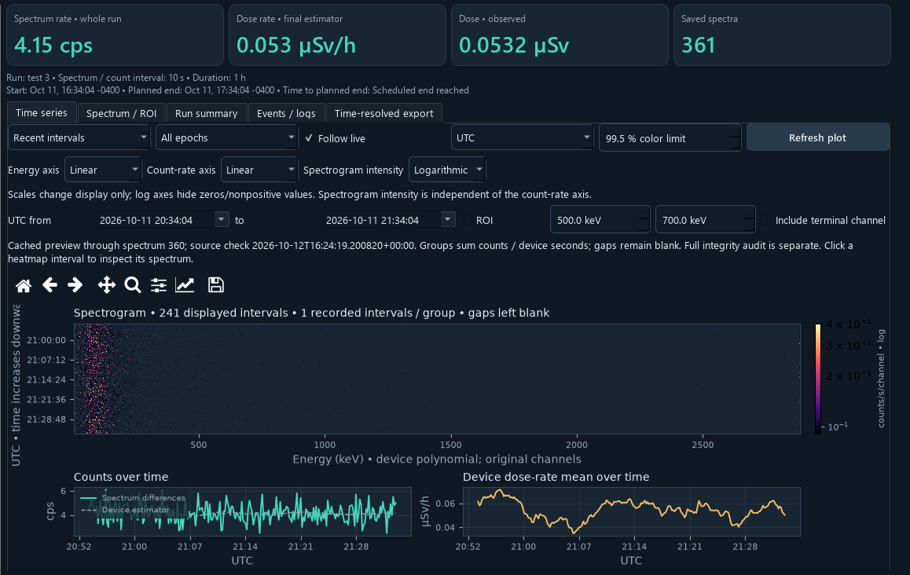
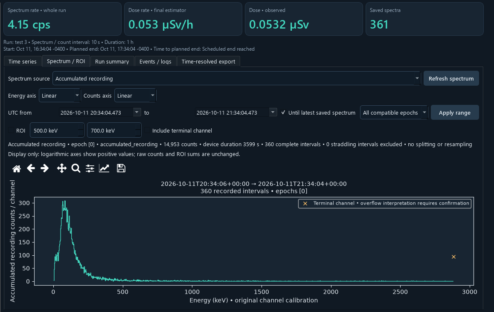

  

  <b>Unattended, verifiable time-resolved gamma spectroscopy with RadiaCode detectors on Windows.</b>

GammaKeeper (formerly RadiaLog) records a gamma spectrum every few seconds for days at a time, and keeps every one of them: immutable, hash-verified raw records, a crash-safe journal, SNTP-referenced timing, and automatic reconnection that never invents data. It was built for sealed-canister measurements of radon (Rn-222) adsorbed on activated charcoal, where the signal is the slow decay of the Pb-214 and Bi-214 photopeaks over several days. The faint spectrum behind the splash screen is that radon-progeny spectrum.

## What it does

- **Time-resolved spectra without a rolling buffer.** Each interval's 1,024-channel spectrum is the exact integer difference of the device's cumulative spectra, normalized by the measured device exposure. Nothing is overwritten, smoothed or resampled.
- **Survives the real world.** A supervisor restarts the recorder, USB faults back off and reconnect, and counts accumulated during a gap are kept as one flagged aggregate rather than lost or spread over invented bins. Interrupted runs can be resumed until their planned end.
- **Proves its own data.** Raw records are immutable and SHA-256 indexed; resume verifies them before acquiring; completed runs get a background audit and export.
- **Honest timing.** UTC comes from validated SNTP measurements bound to the monotonic clock, with the uncertainty and reference age saved alongside the data.
- **Analysis-ready exports.** CSV/NPZ time bins, nonoverlapping or moving-average spectra, native RCSPG, and XLSX matrices for fitting tools, each with full provenance.
- **One job per device.** A per-serial lock keeps two recorders from sharing a detector, across old and new releases.

  
  

## Quick start

You need Windows 10/11, a RadiaCode detector on USB (tested with a RadiaCode 103), and Python 3.12 with PySide6, NumPy and Matplotlib (versions in [`app/requirements-app.txt`](app/requirements-app.txt)).

**Install (recommended).** Double-click [`tools\install_gammakeeper.cmd`](tools/install_gammakeeper.cmd) in Explorer. It fetches the latest `main` (or the tag you pass), exports a clean copy into `GammaKeeper Releases\` next to the repository, rebuilds the device libraries, runs the full test suite, activates the release only if every test passes, and creates **GammaKeeper** shortcuts on the Desktop and in the Start Menu. Run it again to update: each install sits beside the previous ones, so a recording started by an older build keeps running, and rolling back is one command. The repository's working files are only read. [`tools\uninstall_gammakeeper.cmd`](tools/uninstall_gammakeeper.cmd) removes the shortcuts and leaves releases and data alone.

**Or run from the checkout.** `python -X utf8 tools\vendor_dependencies.py` once, then `app\Launch_GammaKeeper.cmd`.

**Record.** Close the manufacturer's app (the USB handle is exclusive), enter a label, confirm the serial number, interval and duration, and click **Start new recording**. New runs go to `Desktop\Radiacode Data\GammaKeeper Runs` unless you choose another folder (or set `GAMMAKEEPER_DATA_ROOT`). Closing the window does not stop the recording.

The [manual](docs/manual.md) covers operation, data formats, scientific conventions and limits in detail.

## Documentation

| Document | Contents |
|---|---|
| [Manual and release notes](docs/manual.md) | operation, data and scientific meaning, timing and reconnection, exports, validation, release history |
| [Time-resolved export](docs/TIME_RESOLVED.md) | schedule input, export modes, file formats, fitting caveats |
| [Display scales](docs/DISPLAY_SCALES.md) | linear/log axes and what they do and do not change |
| [Contributing](CONTRIBUTING.md) · [Agent rules](AGENTS.md) | repository layout, workflow, releases |
| [Development plan](docs/plan/) | current plan (highest version) and its evidence |

## Repository layout

| Path | Contents |
|---|---|
| `app/` | the application: recorder, supervisor, storage, analysis and export modules, the `ui/` window, `tests/`, launcher |
| `docs/` | manual, topic guides, images, development plan |
| `tools/` | installer and shortcuts, release deployment, dependency vendoring, identity artwork, privacy audit, git hooks |
| `history/` | provenance of the imported RadiaLog v0.1–v0.5.1 releases |

## Status

GammaKeeper is pre-1.0. The automated suite runs on every pull request (unit and synthetic GUI tests on Windows). Multi-day qualification with the detector, including a sealed-charcoal half-life check, is planned before the first experimental release; see the development plan.

## Name, credits and license

Releases v0.1–v0.5.1 were published as **RadiaLog**; identifiers they share with GammaKeeper (the device lock, run-folder and manifest formats) are unchanged, so old runs open and old and new releases never record from the same detector at once.

GammaKeeper builds on the MIT-licensed [cdump/radiacode](https://github.com/cdump/radiacode) protocol library, and its recording approach was informed by [ckuethe/radiacode-tools](https://github.com/ckuethe/radiacode-tools). Third-party notices are in [`app/THIRD_PARTY.md`](app/THIRD_PARTY.md). It is independent community software, not affiliated with RadiaCode / Scan-Electronics.

Licensed under the [MIT License](LICENSE).
